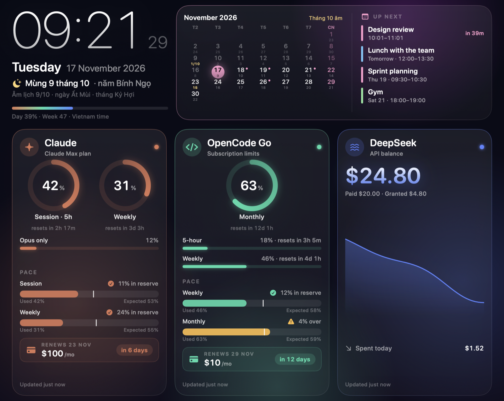

# Sidecar Dash

An always-on dashboard for an iPad used as a Sidecar screen. It's a small native macOS app that fills the iPad with a clock, a calendar and live usage for your AI coding subscriptions.



*The screenshot uses the app's built-in sample data (`--demo`).*

## What it shows

- **Clock and date:** a large clock with seconds, the weekday and date, and a bar for how much of the day has passed.
- **Vietnamese lunar date (âm lịch):** for example *Mùng 9 tháng 10 · năm Bính Ngọ*, plus the can chi of the day and month. It is computed for Vietnam time (UTC+7), which differs from the Chinese calendar on some days. Mùng 1 and Rằm are highlighted.
- **Calendar:** a month grid (weeks start on Monday) with the lunar day under each date and dots on days with events, plus "Up next" with your next 4 events. It reads every calendar in the Mac's Calendar app, so iCloud, Google and Outlook/Exchange all work.
- **Claude:** 5-hour session and weekly limits as rings, any model-specific limits, pace against the reset, and your monthly price and next charge date.
- **OpenCode Go:** the monthly limit as a ring, the 5-hour and weekly limits, pace, price and renewal date (read automatically).
- **DeepSeek:** API balance (paid and granted), today's spending, and a 24-hour balance chart.
- Limits turn amber at 75% and red at 90%. The billing line turns amber 3 days before a charge.

## How it works

- The window covers the screen whose name contains "Sidecar" or "iPad". It hides when the iPad disconnects and comes back when it reconnects.
- Usage comes from the [CodexBar](https://codexbar.app/) command-line tool, so it uses the logins CodexBar already has. Sidecar Dash stores no keys. Claude refreshes every 5 minutes, OpenCode and DeepSeek every 3 minutes, and everything refreshes when the Mac wakes.
- Calendar events come from EventKit after you allow calendar access once.
- It runs as a menu-bar-only app (no Dock icon), starts at login through a LaunchAgent, and restarts if it crashes. It uses about 100 MB of memory and under 1% CPU.

## Requirements

- macOS 14 or later, with Xcode or the Xcode Command Line Tools (Swift 5.10+).
- An iPad connected as a Sidecar display (Control Centre → Display → choose the iPad).
- [CodexBar](https://codexbar.app/), signed in to the providers you want: `brew install --cask codexbar`. The app looks for the CLI at `/opt/homebrew/bin/codexbar`, `/usr/local/bin/codexbar` or inside `/Applications/CodexBar.app`.

## Install

```bash
git clone https://github.com/dinhdobathi1992/sidecar-dashboard.git
cd sidecar-dashboard
./install.sh
```

`install.sh` builds a release binary, creates `~/Applications/Sidecar Dash.app`, signs it ad hoc and installs the LaunchAgent `~/Library/LaunchAgents/com.thi.sidecardash.plist`, which starts the app now and at every login. Run it again after any code change.

To uninstall:

```bash
launchctl bootout "gui/$(id -u)/com.thi.sidecardash"
rm -rf ~/Library/LaunchAgents/com.thi.sidecardash.plist "$HOME/Applications/Sidecar Dash.app"
```

## Set up

1. **Check the providers in CodexBar.** Each of these should print JSON without an error:

   ```bash
   codexbar usage --provider claude --json
   codexbar usage --provider opencodego --json
   codexbar usage --provider deepseek --json
   ```

   For Claude, the app first tries CodexBar's `cli` source, which reads the plan Claude Code is signed in to, and falls back to CodexBar's default.

2. **Allow calendar access.** On the first launch macOS asks for calendar access. The prompt can open on a different monitor from the iPad. If you missed it, use the menu bar gauge → **Calendar Access…**.

3. **Add Google or Outlook calendars** (optional) in System Settings → Internet Accounts, with Calendars turned on. Use Google for Google Calendar, and Microsoft Exchange or Outlook.com for Outlook. If your company blocks that sign-in, publish your Outlook calendar as an ICS link and add it in Calendar with File → New Calendar Subscription.

4. **Enter your billing** with the menu bar gauge → **Billing…**: the Claude monthly price and the day of the month it charges, and the OpenCode Go price. OpenCode's renewal date is read automatically. The defaults are $100 (Claude Max 5x) and $10 (OpenCode Go). Include any VAT you pay.

## Menu bar

The gauge icon in the menu bar has:

| Item | What it does |
|---|---|
| Refresh Now (⌘R) | Refreshes usage and calendar. Double-tapping the dashboard does the same. |
| Keep Screens Awake | Stops the displays sleeping. This also keeps your other monitors awake, so it is off by default. |
| Widgets | Turn Clock & Date, Lunar Date, Calendar, Claude, OpenCode Go and DeepSeek on or off. The layout adjusts. |
| Background | **Add Images…** to use your own photos (copied to `~/Library/Application Support/SidecarDash/Backgrounds`); several photos rotate every 15 minutes. **Next Image**, **Show Images Folder**, and **Use Photo Background** to switch back to the gradient. |
| Billing… | Prices and Claude's charge day. |
| Calendar Access… | Asks for access again and opens the Calendars privacy settings. |

## Other settings

- **A different target screen:** by default the app uses the screen whose name contains "Sidecar" or "iPad". To use another one, set part of its name:

  ```bash
  defaults write com.thi.sidecardash screenName "LG"
  ```

- **Sample data:** `.build/release/SidecarDash --demo` shows made-up usage, balance and events, and reads nothing from CodexBar or your calendars. Stop the installed copy first (`launchctl bootout "gui/$(id -u)/com.thi.sidecardash"`), and run `./install.sh` afterwards to start it again.

## Project layout

| File | Purpose |
|---|---|
| `Sources/SidecarDash/main.swift` | App delegate, the window on the iPad, menu bar menu |
| `Sources/SidecarDash/DashboardView.swift` | All dashboard views |
| `Sources/SidecarDash/DashboardStore.swift` | Refresh timers and DeepSeek balance history |
| `Sources/SidecarDash/CodexBarClient.swift`, `Models.swift` | Runs the CodexBar CLI and decodes its JSON |
| `Sources/SidecarDash/CalendarFeed.swift` | Calendar events through EventKit |
| `Sources/SidecarDash/LunarCalendar.swift` | Vietnamese lunar calendar (Hồ Ngọc Đức's algorithm) |
| `Sources/SidecarDash/Settings.swift` | Widget switches, photo backgrounds, billing |
| `Sources/SidecarDash/Demo.swift` | Sample data for `--demo` |
| `install.sh` | Build, install and start at login |

## Troubleshooting

- **The dashboard doesn't appear:** check that the iPad is connected as a Sidecar display and that `pgrep -x SidecarDash` prints a process ID.
- **A card says it couldn't refresh:** run the matching `codexbar usage` command above. The card keeps the last good numbers until a refresh works.
- **The calendar says "No calendar access":** allow Sidecar Dash in System Settings → Privacy & Security → Calendars. After rebuilding, the app keeps its permission because `install.sh` signs it with a fixed identity.
